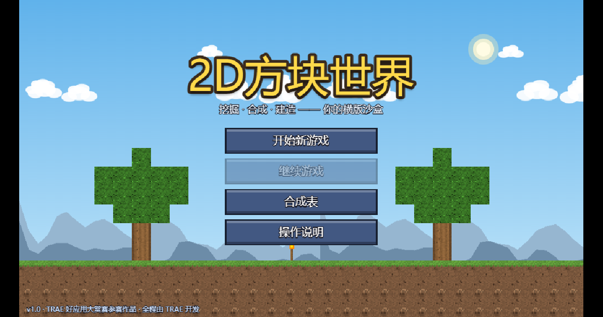
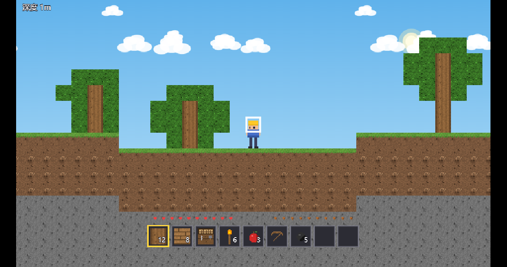
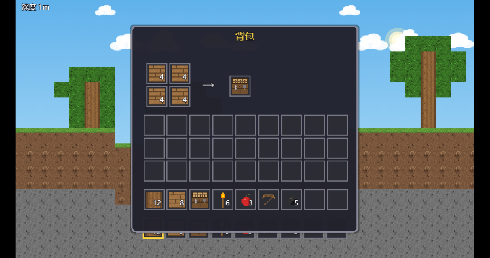
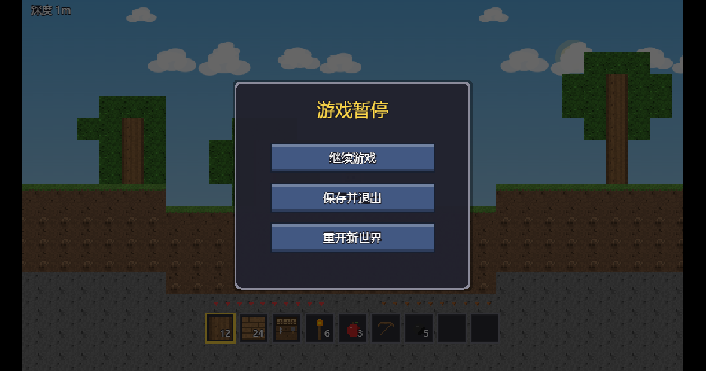

# 2D方块世界 · BlockWorld2D

一个纯网页端的 **2D 横版沙盒挖掘建造游戏**：程序生成的世界、砍树挖矿、合成工具、地下光照、生存要素，全部装进一个 HTML 文件里。

> 🎮 **在线游玩**：开启 GitHub Pages 后访问仓库主页地址即可，或直接下载 `index.html` 双击打开（Chrome / Edge）。
>
> TRAE 好应用大赏赛 · 游戏娱乐赛道 · 网页应用 · **全程由 TRAE 开发**



## 立即开始

**方式一：直接玩**

下载仓库根目录的 `index.html`，双击用 Chrome / Edge 打开。这是构建好的单文件版本，不需要服务器、不需要安装任何东西。

**方式二：从源码运行**

```bash
cd source
npm install
npm run dev        # http://localhost:5173
npm run build      # 重新产出单文件 index.html
```

**方式三：GitHub Pages**

仓库 → Settings → Pages → Source 选择 `Deploy from a branch` → 分支 `main`、目录 `/ (root)` → 保存。
几分钟后访问 `https://<你的用户名>.github.io/<仓库名>/` 即可在线游玩。

## 特性

- **程序化世界**：512×128 格，两阶价值噪声起伏地形 + 洞穴 + 沙地 + 树木，同一 seed 结果完全一致
- **四种矿物**：煤 / 铁 / 金 / 钻石按世界绝对深度分布，越深越稀有
- **完整合成链**：木头 → 木板 → 木棍 → 工作台 → 木镐 → 石镐 → 铁镐 → 钻石镐，8 条原版式有形配方（按图案摆放、支持镜像）
- **工具门槛**：等级不足能破坏但无掉落；等级越高挖得越快
- **地下光照**：越深越暗，火把在黑暗中照出光圈
- **生存要素**：摔落伤害、饥饿消耗与自然回复、苹果食物、死亡重生（物品保留）
- **操作手感**：潜行防坠落、双击 / Ctrl 疾跑、分轴 AABB 碰撞无穿墙
- **区块渲染**：16×16 格区块离屏缓存，只重绘脏区块，按视野动态创建/回收
- **零外部素材**：全部贴图由 Canvas 程序化绘制（16×16 像素风），全部音效由 Web Audio 实时合成
- **增量存档**：localStorage 只保存方块改动 diff，10 秒自动保存，存档损坏自动回退



## 操作说明

| 操作 | 按键 |
|---|---|
| 左右移动 | `A` `D` 或 `←` `→` |
| 跳跃 | `空格`（或 `W`） |
| 潜行（防坠落） | `Shift` |
| 疾跑 | 双击方向键，或按住 `Ctrl` + 方向 |
| 挖掘 | 鼠标左键按住（裂纹进度反馈） |
| 放置 | 鼠标右键（空格 + 相邻实心方块 + 不与玩家重叠） |
| 快捷栏 | 数字键 `1`–`9` / 鼠标滚轮 / 点击格子 |
| 背包 / 2×2 合成 | `E` |
| 物品分堆 | 拿起物品后按住左键扫过其他格子逐格分发；右键拿一半 / 放一个；双击收集同类 |
| 食用食物 | 选中食物按住右键，或左键点空处 |
| 使用工作台（3×3） | 右键已放置的工作台 |
| 静音 / 取消静音 | `M` |
| 暂停 | `Esc` |



## 新手引导（一局完整流程）

1. **撸树**：走到树旁，对准树干按住左键，收集木头
2. **合成**：按 `E` 打开背包，按标题页「合成表」的图案摆放——木头 → 木板 ×4；木板竖放两格 → 木棍 ×4；木板填满 2×2 → 工作台
3. **放工作台**：快捷栏选中工作台，右键放在地上，再右键它打开 3×3 合成
4. **做镐**：顶排 3 个材料 + 中列 2 根木棍 → 各级镐；挖石头做石镐，向下挖煤、铁、金、钻石
5. **照明**：煤 + 木棍 → 火把 ×4，放在地下照亮周围
6. **生存**：注意饥饿（疾跑消耗 ×3），树叶有 15% 概率掉苹果；摔落超过 3 格受伤
7. **续玩**：进度自动保存，关页面后从标题页「继续游戏」恢复



## 仓库结构

```
├── index.html          # 主文件：构建好的单文件游戏（GitHub Pages 入口，双击可玩）
├── screenshots/        # 游戏截图
└── source/             # 完整源码（Vite + TypeScript + Phaser 3）
    ├── index.html      # 源码入口（需 npm run dev）
    ├── src/
    │   ├── config.ts       # 全部可调常量
    │   ├── blocks.ts       # 方块/物品注册表
    │   ├── textures.ts     # 程序化纹理生成
    │   ├── world/          # 地形生成 / 方块数据 / 区块渲染
    │   ├── entities/       # 玩家 / AABB 碰撞
    │   ├── systems/        # 挖掘 / 背包 / 合成 / 生存 / 光照 / 存档 / 音效
    │   ├── scenes/         # 启动 / 标题 / 游戏主场景
    │   └── ui/             # HUD / 背包 / 暂停 / 死亡界面
    ├── tests/              # 逻辑单元测试
    └── MANUAL.md           # 完整技术说明（系统细节、参数表、架构）
```

## 技术栈

- **Vite 5 + TypeScript 5 + Phaser 3.90**（唯一运行时依赖，MIT 许可）
- 自定义瓦片 AABB 分轴碰撞、区块离屏 Canvas 渲染
- Canvas 程序化纹理生成器 + Web Audio 8-bit 音效合成器
- localStorage 增量存档（只存玩家改动的方块 diff，读取时全字段校验）
- 构建产物由 `vite-plugin-singlefile` 内联为单个 HTML 文件

详细的系统设计、参数表与实现说明见 [source/MANUAL.md](source/MANUAL.md)。

## 开发验证

```bash
cd source
npm run typecheck   # TypeScript 类型检查
npm test            # 逻辑单元测试
npm run build       # 生产构建
```

## 许可

- 本项目以 [MIT](source/LICENSE) 许可发布
- [Phaser](https://phaser.io) 为 MIT 许可，声明见 [NOTICE](source/NOTICE)
- 所有贴图与音效均由代码程序化生成，未使用任何第三方素材
- 游戏不收集任何用户数据，存档仅保存在浏览器本地
